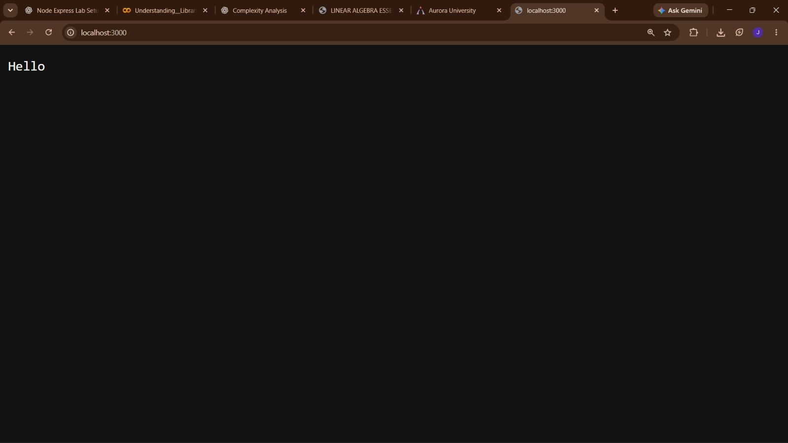
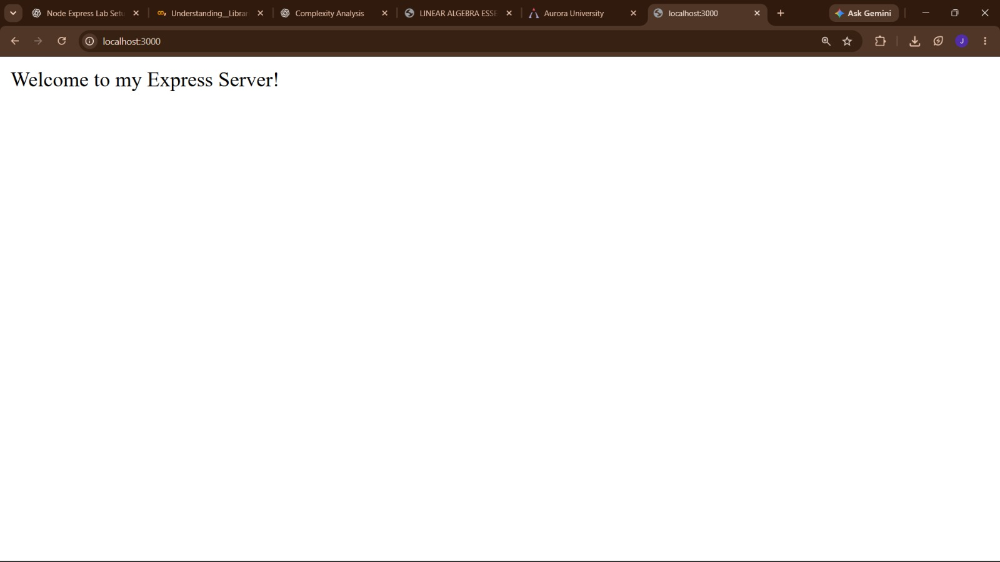
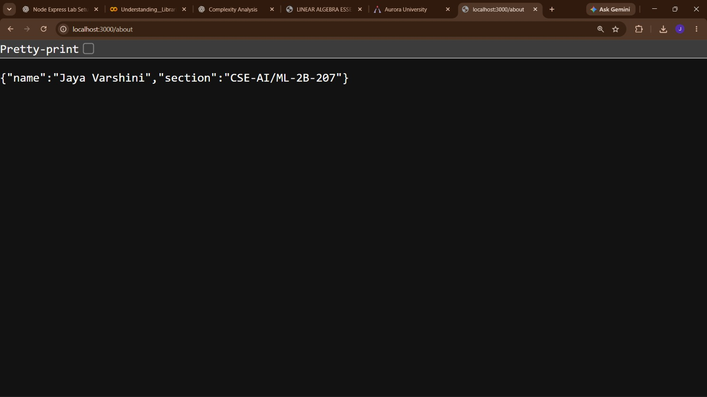
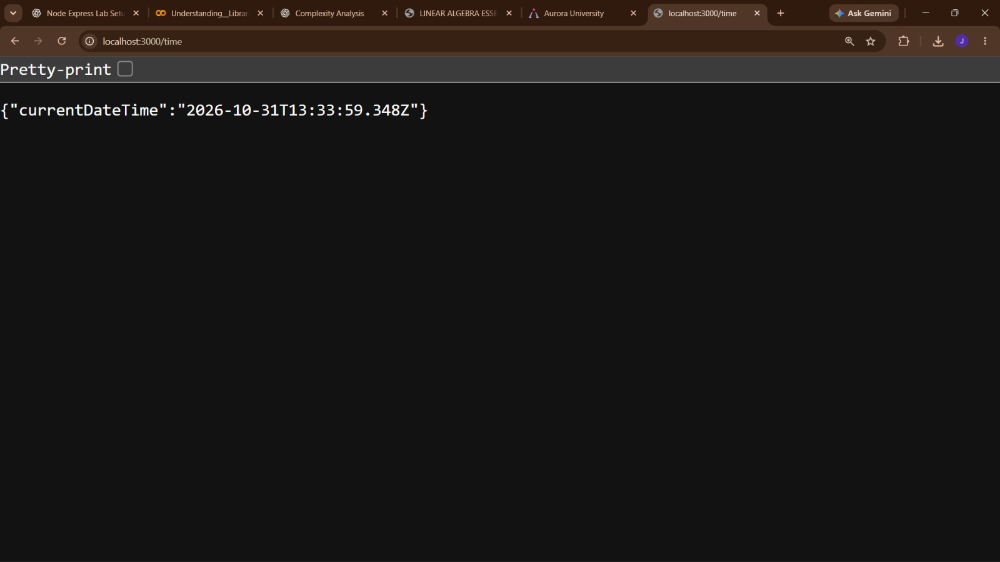
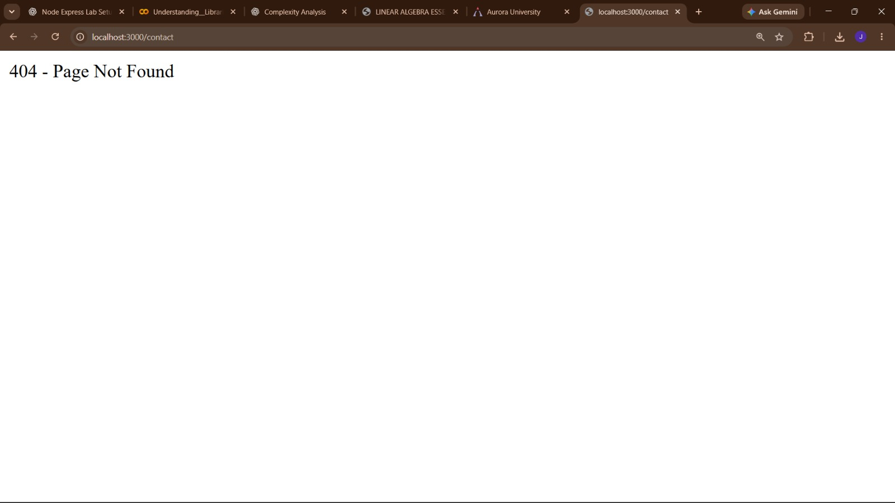

# Node Express Lab 01

## Live Demo
🚀 **Live Application:** https://node-express-lab-01.onrender.com

## GitHub Repository
🔗 https://github.com/jayavarshini2505-hub/node-express-lab-01

---

## Project Description

This project demonstrates the implementation of a basic HTTP server using Node.js and an Express.js server with multiple routes.

It includes different HTTP endpoints to display a welcome message, student information, current date and time, and a custom 404 error message.

## Technologies Used

- Node.js
- Express.js
- JavaScript
- Git and GitHub
- Render (Deployment)

## Project Structure

```text
lab-01/
│
├── node_modules/
├── screenshots/
│   ├── about.png
│   ├── home.png
│   ├── http-server.png
│   ├── not-found.png
│   └── time.png
│
├── .gitignore
├── http-server.js
├── package.json
├── package-lock.json
├── README.md
└── server.js
```

## Features

1. **HTTP Server:** Creates a basic server using Node.js.
2. **Home Route:** Displays a welcome message.
3. **About Route:** Displays student name and section in JSON format.
4. **Time Route:** Displays the current date and time.
5. **404 Handler:** Displays a custom message for invalid routes.
6. **Deployment:** Hosts the Express application using Render.

## API Routes

| Method | Endpoint | Description |
|---|---|---|
| GET | `/` | Displays welcome message |
| GET | `/about` | Displays student details |
| GET | `/time` | Displays current date and time |
| GET | `/invalid` | Displays 404 error message |

## Local Setup Instructions

**Step 1:** Clone the repository.

```bash
git clone https://github.com/jayavarshini2505-hub/node-express-lab-01.git
```

**Step 2:** Navigate to the project directory.

```bash
cd node-express-lab-01
```

**Step 3:** Install dependencies.

```bash
npm install
```

**Step 4:** Start the Express server.

```bash
node server.js
```

**Step 5:** Open the application in your browser.

```text
http://localhost:3000
```

## Screenshots

### 1. HTTP Server



### 2. Home Route



### 3. About Route



### 4. Time Route



### 5. 404 Not Found



## Deployment

The Express application is deployed using **Render**.

**Live URL:** https://node-express-lab-01.onrender.com

The application uses the environment-provided port for deployment and port 3000 for local execution.

## Author

**Name:** Jaya Varshini

**Section:** CSE-AI/ML-2B-207

---

⭐ Thank you for visiting my Node Express Lab repository!