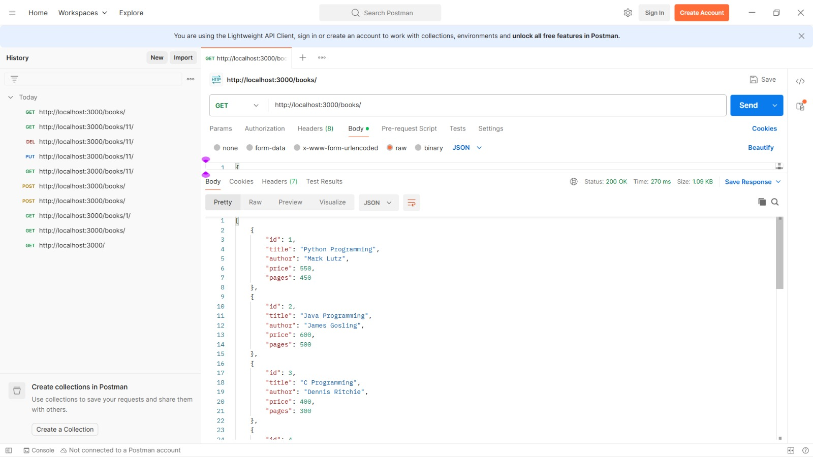
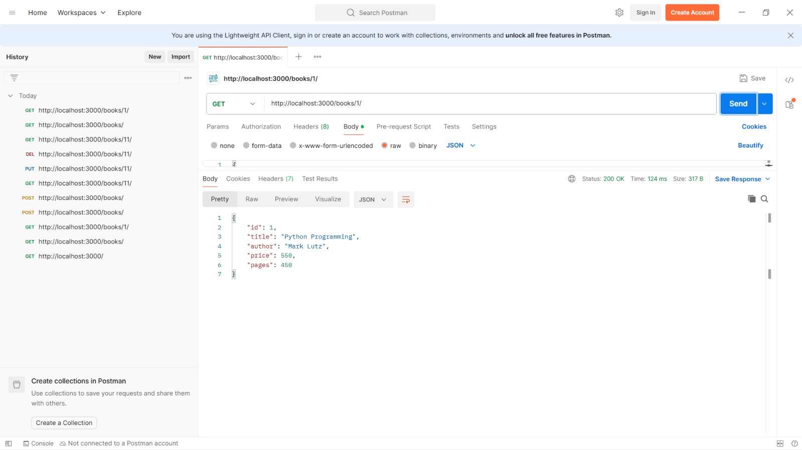
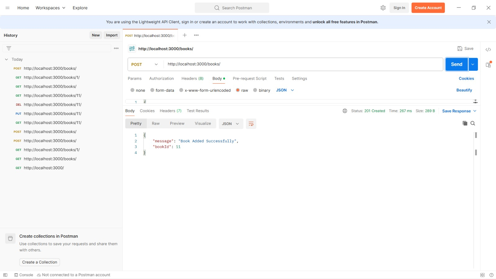
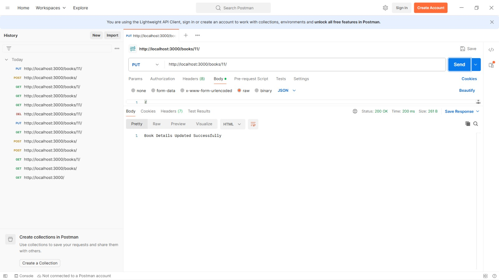
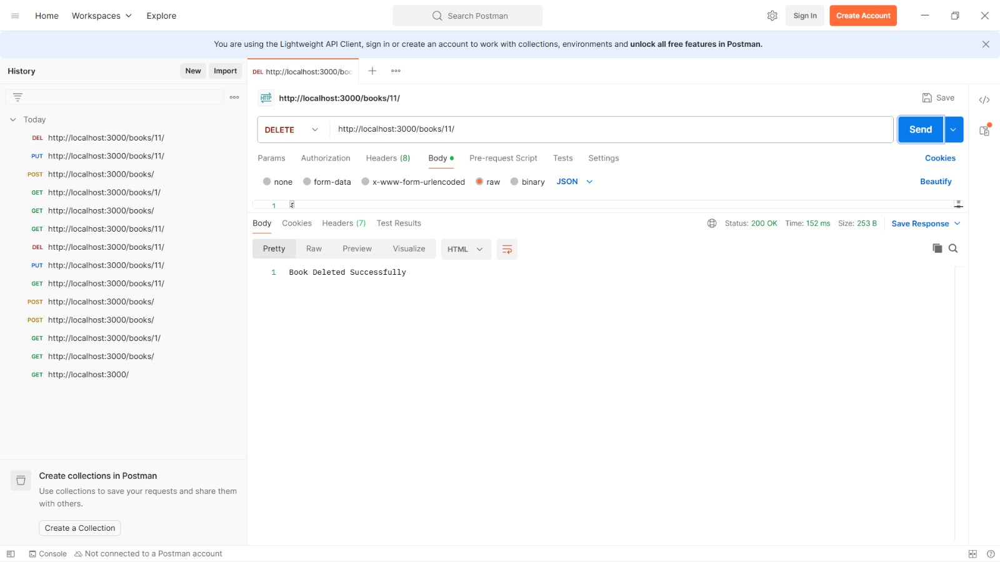

# Lab 2: SQLite Database and CRUD Routes

**Name:** Jaya Varshini  
**Registration Number:** 252U1R6099  
**Section:** CSE-AI/ML-2B-207

## 1. Objective

To connect an Express.js server with an SQLite database and implement CRUD (Create, Read, Update, Delete) operations through HTTP API routes. This experiment demonstrates how to create, retrieve, update, and delete book records using REST API endpoints.

## 2. Technologies Used

- Node.js
- Express.js
- SQLite
- sqlite3
- sqlite
- Nodemon
- Postman

## 3. Installation and Setup

Initialize the Node.js project and install the required dependencies:

```bash
npm init -y
npm install express sqlite sqlite3
npm install --save-dev nodemon
```

Start the application using:

```bash
npm run dev
```

The server runs at:

```text
http://localhost:3000/
```

## 4. Database Details

**Database Name:** `database.db`  
**Table Name:** `book`

The book table contains the following columns:

| Column | Data Type | Description |
|---|---|---|
| id | INTEGER | Primary key |
| title | TEXT | Book title |
| author | TEXT | Author name |
| price | INTEGER | Book price |
| pages | INTEGER | Number of pages |

A total of 10 book records were inserted into the database using the SQLite command-line interface.

## 5. API Endpoints

The following REST API endpoints are implemented:

| HTTP Method | Endpoint | Description |
|---|---|---|
| GET | `/books/` | Retrieves all books |
| GET | `/books/:bookId/` | Retrieves a book using its ID |
| POST | `/books/` | Adds a new book |
| PUT | `/books/:bookId/` | Updates an existing book |
| DELETE | `/books/:bookId/` | Deletes a book using its ID |

## 6. Example API Request

### POST – Add a New Book

**URL:** `http://localhost:3000/books/`

**Request Body:**

```json
{
  "title": "Advanced JavaScript",
  "author": "John Smith",
  "price": 650,
  "pages": 400
}
```

**Expected Response:**

```json
{
  "message": "Book Added Successfully",
  "bookId": 11
}
```

## 7. Postman Screenshots

### 7.1 GET – Retrieve All Books

This endpoint retrieves all the book records stored in the SQLite database.



### 7.2 GET – Retrieve Book by ID

This endpoint retrieves the details of a particular book using its ID.



### 7.3 POST – Add a New Book

This endpoint inserts a new book record into the database.



### 7.4 PUT – Update Book Details

This endpoint updates the details of an existing book using its ID.



### 7.5 DELETE – Delete a Book

This endpoint deletes a book record from the database using its ID.



## 8. Project Structure

```text
lab-02/
│
├── screenshots/
│   ├── get-all-books.png
│   ├── get-book-by-id.png
│   ├── post-book.png
│   ├── update-book.png
│   └── delete-book.png
│
├── .gitignore
├── app.js
├── database.db
├── package.json
├── package-lock.json
└── README.md
```

**Note:** The `node_modules` folder is excluded from the GitHub repository using `.gitignore`. Dependencies can be installed using `npm install`.

## 9. Learning Outcomes

- Learned how to connect an Express.js application with an SQLite database.
- Understood how to create database tables and insert records.
- Implemented GET, POST, PUT, and DELETE API operations.
- Learned how to perform asynchronous database operations.
- Understood the importance of parameterized SQL queries.
- Tested REST API endpoints using Postman.
- Verified database records using SQLite CLI.

## 10. Conclusion

This experiment successfully demonstrates the integration of an SQLite database with an Express.js server. Five CRUD API endpoints were implemented and tested using Postman. The experiment helped in understanding database connectivity, HTTP methods, SQL queries, and backend API development.