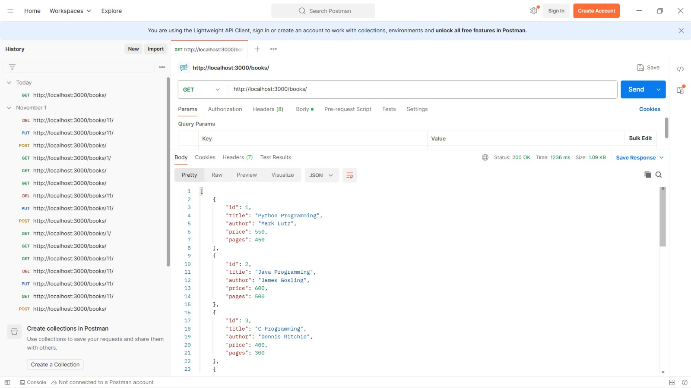
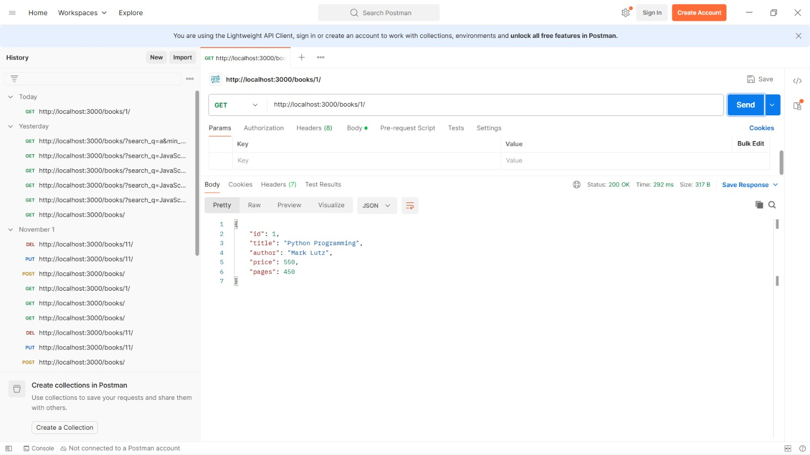
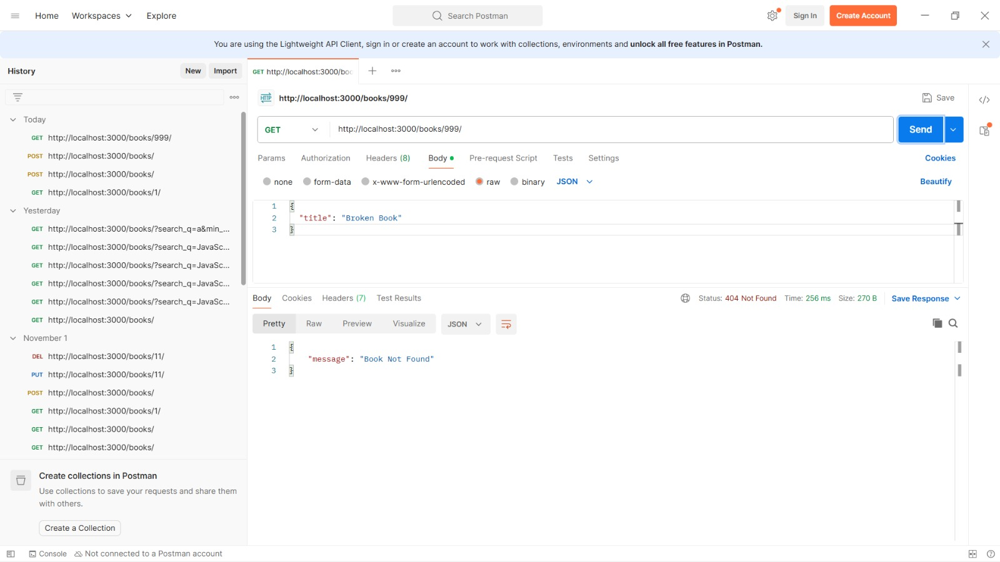
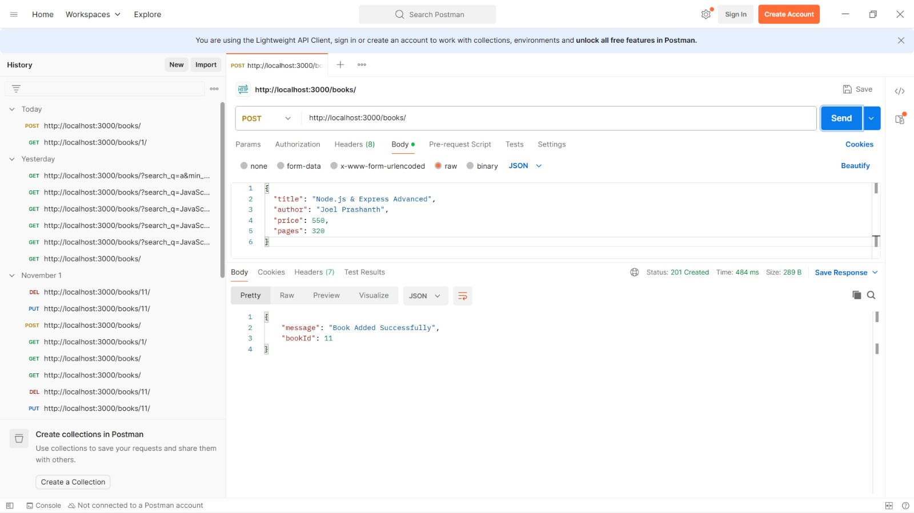
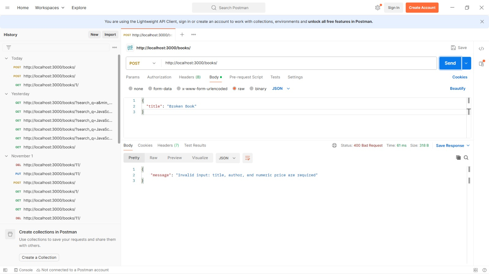
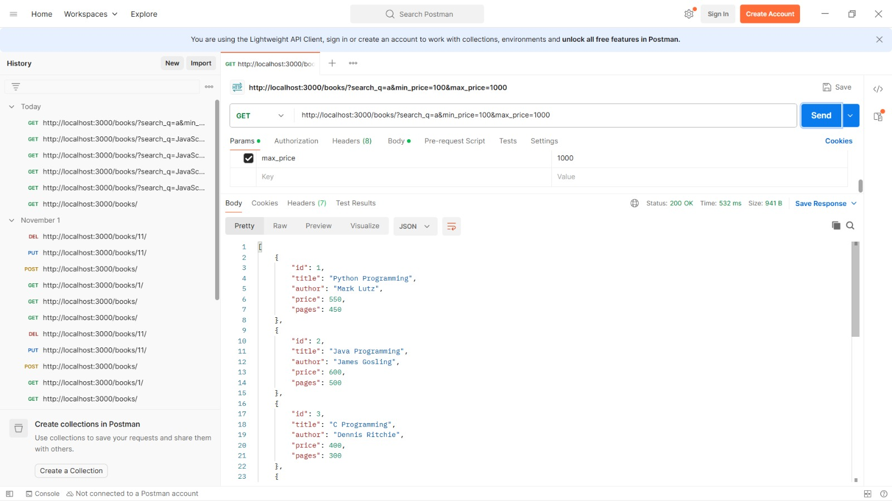

# Lab 3: REST API, Query Parameters, Validation and Debugging

# Student Details
- **Name:** Jaya Varshini
- **Registration Number:** 252U1R6099
- **Section:** CSE-AI/ML-2B-207
- **Course:** Backend Development Fundamentals
- **Year and Term:** Year II – Term II

# Live Demo
**Live Application:** https://node-express-lab-03.onrender.com/
# GitHub Repository
**Repository:** https://github.com/jayavarshini2505-hub/node-express-lab-01

# Objective
To develop a clean REST API using Node.js, Express.js and SQLite by implementing search, sorting, filtering, pagination and input validation. This lab also focuses on appropriate HTTP status codes, consistent JSON responses and debugging common backend errors.

# Technologies Used
- Node.js
- Express.js
- SQLite
- sqlite and sqlite3
- JavaScript
- Nodemon
- Postman

# Project Structure
**lab-03/**

# Installation and Setup
1. *Clone the repository*
git clone https://github.com/jayavarshini2505-hub/node-express-lab-01.git
2. Navigate to Lab 3
cd node-express-lab-01/lab-03
3. Install dependencies
npm install
4. Start the server
npm run dev
If the project does not define a dev script, run:
node app.js
5. Local URL
http://localhost:3000

**Environment variables:** No additional environment variables are required for the current local setup. The application uses the SQLite database file included in the project.

# API Endpoints
**HTTP Method	Endpoint Description**
1. GET	/books/	Retrieves all books.
2. GET	/books/:bookId/	Retrieves a particular book using its ID.
3. POST	/books/	Adds a new book after validating the request body.
4. PUT	/books/:bookId/	Updates an existing book.
5. DELETE	/books/:bookId/	Deletes a book using its ID.

# Query Parameters
The GET /books/ endpoint supports query parameters for searching, sorting, filtering and pagination.
**Parameter-Description**
1. search_q-Searches books using a partial title match.
2. order_by-Specifies the column used for sorting.
3. order-Specifies the sorting order (ASC or DESC).
4. limit-Specifies the maximum number of records to return.
5. offset-Specifies the number of records to skip.
6. min_price-Specifies the minimum book price.
7. max_price-Specifies the maximum book price.

# Example requests
1. **Search books**
GET /books/?search_q=Java
2. **Sort books**
GET /books/?order_by=price&order=ASC
3. **Pagination**
GET /books/?limit=5&offset=0
4. **Filter books by price**
GET /books/?min_price=100&max_price=1000
5. **Combine search, sorting and pagination**
GET /books/?search_q=Java&order_by=price&order=DESC&limit=5&offset=0

# Request Validation and HTTP Status Codes
The POST endpoint validates the request body before inserting a new book:
- The title and author must be provided.
- The price must be numeric.
- Invalid input returns 400 Bad Request with a clear JSON message.

# Status Code	Description
**200 OK:**	Request completed successfully, including retrieval, update or deletion.
**201:** Created	A new book was successfully added.
**400:** Bad Request	Input data is invalid or required fields are missing.
**404:** Not Found	The requested book ID does not exist.
**500:** Internal Server Error	An unexpected server-side error occurred.

# Postman Testing and Screenshots
The following screenshots are stored in the screenshots/ directory. They are embedded below so that they appear directly in this README on GitHub.
1. **Get All Books:**
Retrieves and displays all available book records.

2. **Get Book by ID:**
Retrieves the details of a particular book using its ID.

3. **Get Book Not Found:**
Shows the response when the requested book ID does not exist.

4. **Add Book Successfully:**
Shows a successful POST request and the 201 Created response.

5. **POST Validation Error:**
Shows the validation response for missing or invalid input.

6. **Search and Filter:**
Shows the use of query parameters for searching and filtering books.

# Debugging and Error Handling
*The lab includes debugging the following common backend errors:*
- EADDRINUSE: Occurs when the selected port is already in use. Stop the process using the port or select another available port.
- Wrong import path: Occurs when a required module or file is referenced using an incorrect path. Correct the import path.
- No such table: Occurs when a query refers to an incorrect database table name. Check the database schema and correct the table name.
- Missing await: Occurs when an asynchronous database operation is not awaited. Use await so the operation completes before its result is used.

# Important Implementation Practices
- Used RESTful endpoint naming conventions.
- Used query parameters for searching, sorting, filtering and pagination.
- Validated request data before database insertion.
- Used appropriate HTTP status codes.
- Used parameterized SQL queries instead of joining user input into SQL strings.
- Maintained consistent JSON response messages.
- Tested API functionality using Postman.
- Excluded node_modules and sensitive .env files from Git.

# Learning Outcomes
- Understood REST API design and HTTP methods.
- Implemented search using query parameters and partial title matching.
- Practised sorting records in ascending and descending order.
- Implemented pagination using limit and offset.
- Applied price-range filtering to database records.
- Implemented request validation and error handling.
- Understood the use of HTTP status codes.
- Practised identifying and resolving common backend errors.
- Tested API endpoints using Postman.

# Problems Faced and Solutions
During implementation and testing, common backend issues were studied and addressed, including port conflicts, incorrect import paths, database table-name errors and missing asynchronous waits. Postman was used to verify successful responses and validation failures.

# Conclusion
This lab provided practical experience in developing REST APIs using Node.js, Express.js and SQLite. It strengthened understanding of route handling, query parameters, searching, sorting, filtering, pagination, input validation, HTTP status codes and backend debugging.