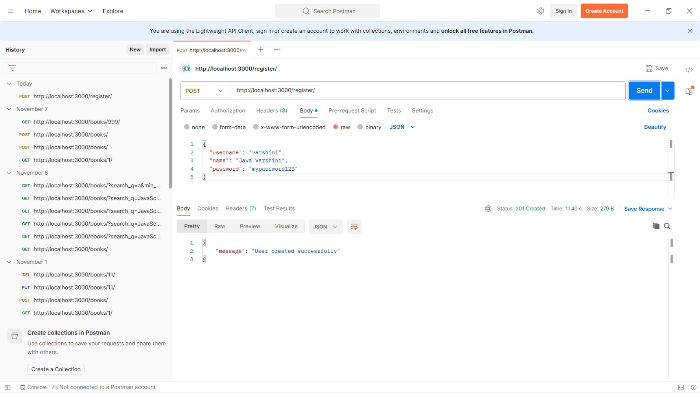
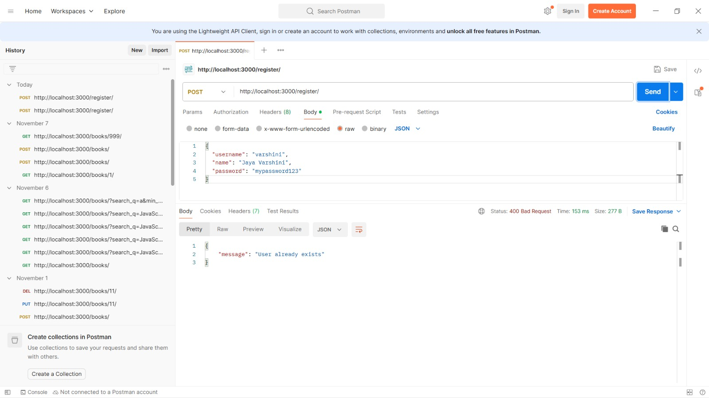
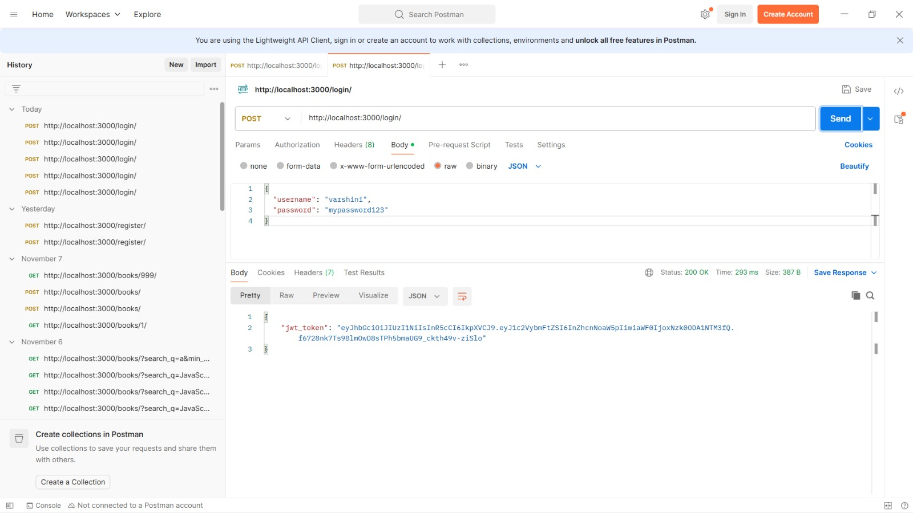
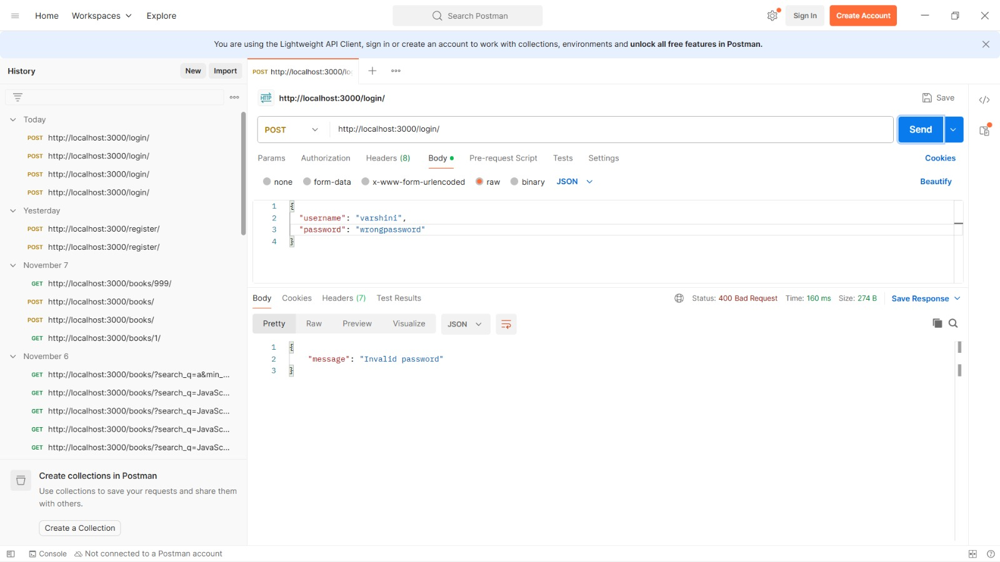
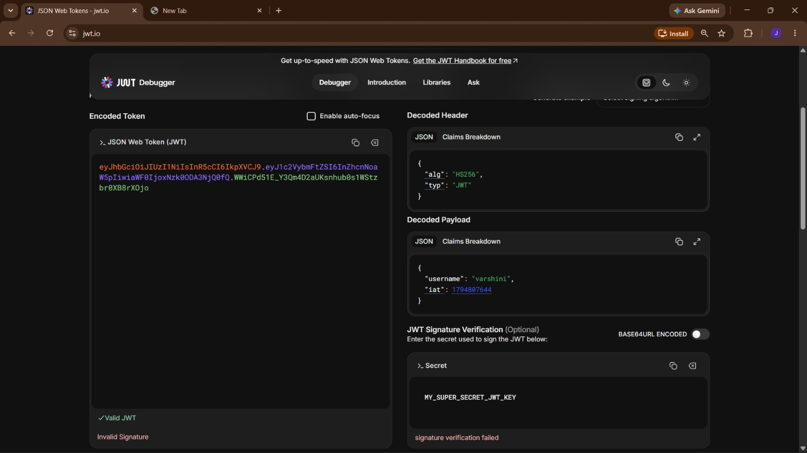

# Lab 4: User Registration, Login and JWT Authentication

## Student Details

- **Name:** Jaya Varshini
- **Registration Number:** 252U1R6099
- **Section:** CSE-AI/ML-2B-207
- **Course:** Backend Development Fundamentals
- **Year and Term:** Year II – Term II

## Live Demo

Live Application: https://node-express-lab-04.onrender.com/[cite: 16]

## GitHub Repository

Repository: https://github.com/jayavarshini2505-hub/node-express-lab-01[cite: 9, 15]

## Objective

To implement secure user registration and login APIs using Node.js, Express.js and SQLite by hashing passwords with `bcrypt` and generating signed JSON Web Tokens (`JWT`) for user authentication. This lab also focuses on input validation, duplicate user handling, appropriate HTTP status codes and token inspection.

## Technologies Used

- Node.js[cite: 10]
- Express.js
- SQLite
- sqlite and sqlite3[cite: 14]
- bcrypt[cite: 14]
- jsonwebtoken[cite: 14]
- JavaScript
- Nodemon[cite: 14]
- Postman[cite: 1, 2, 5]

## Project Structure

```text
lab-04/
├── screenshots/
│   ├── jwt-decoded.png
│   ├── login-invalid-password.png
│   ├── login-invalid-user.png
│   ├── login-success.png
│   ├── register-duplicate.png
│   └── register-success.png
├── .gitignore
├── app.js
├── database.db
├── package-lock.json
├── package.json
└── README.md
```[cite: 9]

## Installation and Setup

1. *Clone the repository* `git clone https://github.com/jayavarshini2505-hub/node-express-lab-01.git`[cite: 9]
2. Navigate to Lab 4 `cd node-express-lab-01/lab-04`
3. Install dependencies `npm install`[cite: 10, 11]
4. Start the server `npm run dev` if the project does not define a dev script, run: `node app.js`[cite: 11, 14]
5. Local URL http://localhost:3000[cite: 7]

**Environment variables:** No additional environment variables are required for the current local setup. The application uses the SQLite database file included in the project and defines the JWT signing secret in `app.js`.

## API Endpoints

**HTTP Method Endpoint Description**

1. `GET /` Returns a welcome message and lists available authentication endpoints.
2. `POST /register/` Registers a new user after checking for duplicate usernames and hashing the password with `bcrypt`.[cite: 1, 2]
3. `POST /login/` Authenticates user credentials using `bcrypt.compare()` and returns a signed `jwt_token`.[cite: 5]

## Request Body Parameters

The `/register/` and `/login/` endpoints accept JSON request bodies with the following fields: **Parameter-Description**[cite: 1, 5]

1. `username` - Unique identifier for the user account (required for both `/register/` and `/login/`).[cite: 1, 5]
2. `name` - Full display name of the user (required for `/register/`).[cite: 1]
3. `password` - Plain-text password sent over the request body, hashed before storage and verified during login (required for both `/register/` and `/login/`).[cite: 1, 5]

## Example Requests

1. **Register a new user** `POST /register/` with JSON body `{"username": "varshini", "name": "Jaya Varshini", "password": "mypassword123"}`[cite: 1]
2. **Duplicate user registration** `POST /register/` with an already registered `username`[cite: 2]
3. **Valid user login** `POST /login/` with JSON body `{"username": "varshini", "password": "mypassword123"}`[cite: 5]
4. **Invalid username login** `POST /login/` with a non-existent `username`
5. **Invalid password login** `POST /login/` with a valid `username` and incorrect `password`

## Request Validation and HTTP Status Codes

The `/register/` and `/login/` endpoints validate incoming requests before interacting with the database or issuing tokens:[cite: 1, 5]

- Required fields (`username`, `name`, `password` for registration; `username`, `password` for login) must be provided.[cite: 1, 5]
- Duplicate usernames are rejected during registration with `400 Bad Request` (`"User already exists"`).[cite: 2]
- Passwords are never stored in plain text or included inside the JWT payload.[cite: 6]
- Unregistered usernames or mismatched passwords return `400 Bad Request` with clear JSON error messages.

## Status Code Description

**200 OK:** Request completed successfully, including server health check and valid user login returning a JWT token.[cite: 5] **201 Created:** A new user account was successfully registered and stored in the database.[cite: 1] **400 Bad Request:** Input data is invalid, required fields are missing, the username already exists, or login credentials do not match.[cite: 2] **500 Internal Server Error:** An unexpected server-side or database error occurred.

## Postman Testing and Screenshots

The following screenshots are stored in the `screenshots/` directory. They are embedded below so that they appear directly in this README on GitHub.[cite: 9, 20]

1. **User Registration Success:** Registers a new user with a hashed password and returns a `201 Created` response.[cite: 1]

[cite: 9]

2. **Duplicate User Registration Error:** Shows the `400 Bad Request` validation response when attempting to register an existing username.[cite: 2]

[cite: 9]

3. **User Login Success:** Verifies valid credentials and returns a `200 OK` response containing the signed `jwt_token`.[cite: 5]

[cite: 9]

4. **Login Invalid User:** Shows the `400 Bad Request` response when the entered username does not exist in the database.

[cite: 9]

5. **Login Invalid Password:** Shows the `400 Bad Request` response when the entered password does not match the stored hash.

[cite: 9]

6. **Decoded JWT Token (jwt.io):** Inspects the generated JWT header (`HS256`), payload (`username` and `iat` claim), and signature structure.[cite: 6]

[cite: 9]

## Security and Authentication Practices

*The lab implements essential backend authentication and password security mechanisms:*

- **Password Hashing (`bcrypt.hash`):** Plain-text passwords are salted and hashed with 10 salt rounds before inserting into SQLite so raw passwords are never stored.
- **Hash Comparison (`bcrypt.compare`):** Login verification compares the incoming plain-text password against the stored cryptographic hash.
- **Stateless JWT Signing (`jwt.sign`):** Generates a compact, URL-safe token containing only non-sensitive user identification (`username`) signed with a secret key.[cite: 6]
- **Token Inspection (`jwt.io`):** Verifies that JWT payloads are Base64Url-encoded and readable, reinforcing why sensitive fields like passwords must never be placed in the payload.[cite: 6]

## Important Implementation Practices

- Used RESTful endpoint naming conventions (`/register/` and `/login/`).[cite: 1, 5]
- Automatically initialized the `user` table in SQLite upon server startup.
- Validated request fields before database queries or token generation.
- Used parameterized SQL queries (`?` placeholders) to prevent SQL injection.
- Hashed passwords using `bcrypt` before storing them in SQLite.
- Excluded sensitive credentials from the JWT payload.[cite: 6]
- Used appropriate HTTP status codes (`200`, `201`, `400`, `500`) and consistent JSON responses.[cite: 1, 2, 5]
- Tested all endpoints and edge cases using Postman and `jwt.io`.[cite: 1, 5, 6]
- Excluded `node_modules` and `.env` files from Git using `.gitignore`.[cite: 9]

## Learning Outcomes

- Understood user authentication workflows using registration and login APIs.[cite: 1, 5]
- Implemented secure password hashing and verification using `bcrypt`.
- Generated and decoded JSON Web Tokens using `jsonwebtoken` and `jwt.io`.[cite: 5, 6]
- Practised preventing duplicate user registrations in SQLite.[cite: 2]
- Implemented request validation and proper HTTP status code handling.
- Diagnosed and resolved native module (`sqlite3`) GLIBC compatibility issues during cloud deployment on Render.[cite: 13, 14]
- Tested API endpoints and error scenarios systematically using Postman.[cite: 1, 2, 5]

## Problems Faced and Solutions

During implementation and cloud deployment, common backend and environment issues were encountered and resolved. When deploying to Render, the default `sqlite3` package version triggered a `GLIBC_2.38 not found` (`ERR_DLOPEN_FAILED`) error on Linux, which was solved by pinning `"sqlite3": "5.1.7"` in `package.json`.[cite: 13, 14] Additionally, `ECONNREFUSED` errors in Postman during local testing were resolved by ensuring the `nodemon` development server was running before sending requests.[cite: 3, 7]

## Conclusion

This lab provided practical experience in building secure authentication endpoints using Node.js, Express.js and SQLite. It strengthened understanding of password hashing with `bcrypt`, stateless token generation with `JWT`, input validation, HTTP status codes and cloud deployment troubleshooting.